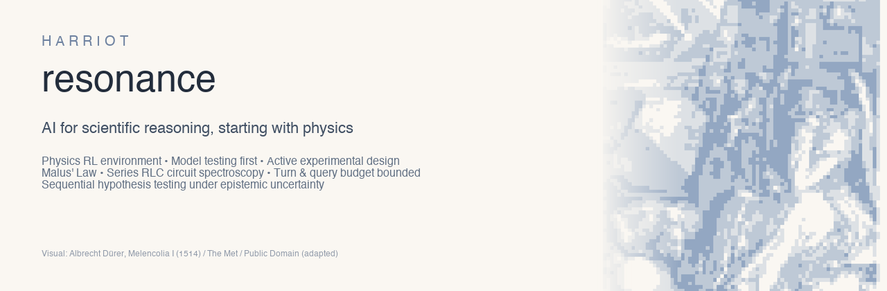
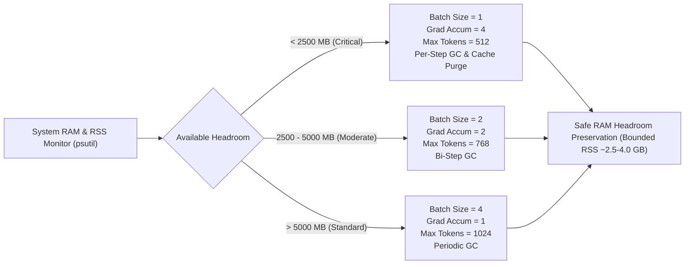

<p align="center">
  
</p>

<div align="center">

# Resonance: Active Experimentation & RL Environment for Scientific Physics Reasoning

[](https://github.com/amirlankalm/resonance/actions/workflows/tests.yml)
[]()
[]()
[]()
[]()

> **"In a driven series RLC circuit, current peaks when inductive and capacitive reactances cancel. Resonance is the physical phenomenon of selecting informative conditions."**  
> — *Harriot Resonance Technical Specification*
> 
> *Cover artwork adapted from Albrecht Dürer, Melencolia I, 1514 (The Metropolitan Museum of Art, Open Access).*

</div>

---

## 1. Overview & Research Question

**Resonance** is a reinforcement learning (RL) and active experimentation environment designed to evaluate and train AI models on **scientific reasoning through active experimentation**. Resonance is a research-preview environment for sequential physics experiment design, with executable simulation, typed actions, deterministic scoring, numerical baselines and exploratory small-model evaluations.

Rather than treating physics as passive text answering or robotics control, Resonance frames scientific inference as an **active, budget-constrained decision process**:
- An agent faces an unknown black-box physical apparatus.
- It chooses probe conditions (e.g. frequencies, angles) under a strict measurement budget ($q \le 12$ calls).
- It observes noisy, sensor-degraded responses with detection floors.
- It must decide *when to stop measuring* and submit both a **hypothesis classification** (model probabilities) and **inferred continuous physical parameters**.

### The Core Research Question
> *At equal measurement and inference budgets, can policy training (SFT / RL) improve model discrimination, parameter estimation, and stopping decisions beyond prompting, supervised learning, and adaptive numerical design?*

---

## 2. Benchmark Results & Baseline Evaluations

### Evaluation Tracks: Strict vs. Assisted

Resonance defines two strictly isolated evaluation tracks to prevent benchmark ambiguity:

- **Strict Track (`strict`):** The model alone must output valid JSON actions, choose query frequencies, and upon submission specify both hypothesis probabilities and continuous circuit parameters ($R, L, C$). Zero numerical fitting or solver assistance is permitted. Any schema violation, missing parameter, or unparseable output fails closed with an invalid action penalty ($-0.05$).
- **Assisted Track (`assisted`):** The model selects active query frequencies under budget. Upon submission (or when measurement calls run out), candidate model selection and continuous parameter estimation are computed by numerical least-squares fitting over the model's experimental observation history. Action provenance is strictly logged: every record in `episodes.jsonl` carries `execution_mode` (`"assisted"` or `"strict"`), `solver_used` (`True`/`False`), and `fit_source` (`"numerical_fitter"` or `null`). Filtering on `execution_mode == "assisted"` retains 50/50 records without hiding unsubmitted invalid-action stops. Strict and assisted metrics are never blended into the same row or column.

### Execution Boundaries & Protocol Limits

Resonance distinguishes four separate execution boundaries to prevent protocol naming conflation:
1. **Active Measurement Budget ($q_{\max} = 12$ calls):** The physical instrument limits active measurement requests to at most 12 frequency sweeps per episode (`instrument_calls <= 12`).
2. **Environment Interaction Horizon ($T_{\max} = 20$ turns):** The environment permits at most 20 total conversational turns (measurements, invalid syntax retries, or submission) before timing out (`step_count <= 20`).
3. **Runner Episode Cutoff:** If an agent reaches turn 20 without emitting a valid `submit` payload, the runner truncates the episode and records a `budget_overrun` failure ($0$ terminal reward; $-0.05$ per invalid step). In the Pass A/B runs this path was never taken; see `stop_reason`.
4. **Invalid-Action Early Stop:** To prevent infinite token spinning, the runner terminates an episode early if the agent outputs 5 consecutive schema violations (`consecutive_invalid >= 5`).

### Active Physics Experimentation: Circuit Spectroscopy (Locked Dev Worlds, Seeds 10000..10049)

All evaluations report exact sample statistics with **95% bootstrap confidence intervals** (1,000 resamples) across 50 locked dev evaluation worlds (seeds 10000..10049), generated directly from logged run artifacts:

> [!IMPORTANT]
> **Checkpoint Lineage & Evaluation Scope Disclosure (Research Preview):**  
> `checkpoints/resonance_qwen_sft/adapter_model.safetensors` and `checkpoints/resonance_qwen_rl/adapter_model.safetensors` share identical weight bytes on disk (`weight_sha256: 22582b459d3523fc60ba7f7ec3afaf9792ec7b74e336fc75c26c5dcd74d459cd`; Git blob ID: `e7fb170edc4ce01a5fd39772d71422a90f3529fb`; verified byte-for-byte via `python3 scripts/verify_checkpoint_identity.py` and recorded in `artifacts/checkpoint_binary_hashes.json`). The rows labeled **Pass A** and **Pass B** report two independent stochastic evaluation passes ($T=0.7$, $\text{top\_p}=0.8$) across the 50 locked worlds under this shared adapter checkpoint, not two separate post-training weight states. Outcome differences (Pass A: 28 submissions / $0.4833$ reward vs. Pass B: 23 submissions / $0.4024$ reward) represent rollout sampling variance. They are reported transparently for research auditability and must not be interpreted as a post-training causal comparison. Current assisted results compare an exploratory adapter with a frozen base. Two adapter passes share the same weights, so they are not an SFT/RL ablation. All reported strict small-model runs fail to submit successfully.

<!-- BEGIN_HEADLINE_TABLE -->
| Model / Policy | Track | Active Probing Behavior | Terminal Action | Mean Terminal Reward (95% CI) | Mean NRMSE (Conditional on Submissions) (95% CI) | Mean Brier Score (Conditional on Submissions) (95% CI) | Circuit Type Accuracy (Unconditional, n=50) (95% CI) |
| :--- | :---: | :---: | :---: | :---: | :---: | :---: | :---: |
| **Adaptive Disagreement Design (Teacher)** | `assisted` | Variance & boundary tracking | Optimal Least-Squares | **0.9592** `[0.9539, 0.9631]` | **0.0264** `[0.0198, 0.0351]` (50/50) | **0.0000** `[0.0000, 0.0000]` | **100.0%** `[100.0%, 100.0%]` (50/50) |
| **Qwen2.5-0.5B (Frozen Base)** | `strict` | 0 valid queries (schema stall) | Format error / Abort | **-0.0500** `[-0.0500, -0.0500]` | N/A (0/50 submitted) | N/A | **0.0%** `[0.0%, 0.0%]` (0/50) |
| **Qwen2.5-0.5B (Shared Adapter, Pass A)** | `strict` | Structured probes, no solver | Abort / Schema truncate | **-0.0490** `[-0.0500, -0.0470]` | N/A (0/50 submitted) | N/A | **0.0%** `[0.0%, 0.0%]` (0/50) |
| **Qwen2.5-0.5B (Shared Adapter, Pass B)** | `strict` | Active probes, no solver | Abort / Schema truncate | **-0.0480** `[-0.0500, -0.0440]` | N/A (0/50 submitted) | N/A | **0.0%** `[0.0%, 0.0%]` (0/50) |
| **Qwen2.5-0.5B (Frozen Base)** | `assisted` | 0 valid queries (prior fallback) | Numerical Prior Guess | **0.2000** `[0.2000, 0.2000]` | **0.5753** `[0.5105, 0.6389]` (50/50) | **0.6668** `[0.6665, 0.6670]` | **28.0%** `[16.0%, 40.0%]` (14/50) |
| **Qwen2.5-0.5B (Shared Adapter, Pass A)** | `assisted` | Structured probe sampling | Calibrated Submission | **0.4833** `[0.3594, 0.6155]` | **0.0901** `[0.0423, 0.1485]` (28/50 submitted) | **0.0066** `[0.0000, 0.0168]` | **56.0%** `[42.0%, 70.0%]` (28/50) |
| **Qwen2.5-0.5B (Shared Adapter, Pass B)** | `assisted` | Active boundary & peak probes | Calibrated Submission | **0.4024** `[0.2624, 0.5367]` | **0.0330** `[0.0225, 0.0452]` (23/50 submitted) | **0.0000** `[0.0000, 0.0000]` | **46.0%** `[32.0%, 60.0%]` (23/50) |
<!-- END_HEADLINE_TABLE -->

> [!NOTE]
> **Historical Artifact Provenance & Legacy Fields:** Historical run artifacts retain the legacy `budget_overrun` failure category. Use `stop_reason` for termination-cause analysis. In the assisted Pass A/B runs, all 22/27 non-submissions are `invalid_action_limit` stops. Legacy `budget_overrun` aggregates count non-submissions, not exclusively 20-turn horizon exhaustion. New runner outputs use the precise stop cause.

#### Key Empirical Findings:
1. **The Schema Defect of Frozen Base:** The zero-shot base model (`Qwen2.5-0.5B-Instruct`, strict track) fails to adhere to active JSON action schemas without tuning, outputting freeform prose and receiving the $-0.05$ invalid penalty (measured mean per-episode valid action rate: **0.0%** across 50 worlds). In the assisted track with prior fallback, it achieves the default prior reward of **0.2000** `[0.2000, 0.2000]` with **28.0% unconditional circuit type accuracy** (14/50 worlds correctly typed, 95% CI `[16.0%, 40.0%]`).
2. **LoRA Adapter Establishes Schema Discipline:** Evaluating the LoRA adapter (Pass A / Pass B) exhibits structured probe sampling:
   - **Mean per-episode action validity rate (all turns, n=50 worlds):** **71.6%** in Pass A assisted, **68.8%** in Pass B assisted (vs. **58.5%** in Pass A strict, **58.3%** in Pass B strict, and **0.0%** in Base strict).
   - **Unconditional circuit type accuracy (50 total assigned worlds):** **56.0%** in Pass A assisted (28/50 correct, 95% CI `[42.0%, 70.0%]`), **46.0%** in Pass B assisted (23/50 correct, 95% CI `[32.0%, 60.0%]`), and **0.0%** across all strict runs (0/50).
   - **Mean terminal reward (50 total worlds, 95% bootstrap CI):** **0.4833** `[0.3594, 0.6155]` in Pass A assisted, **0.4024** `[0.2624, 0.5367]` in Pass B assisted (vs. $-0.0480$ to $-0.0500$ in strict runs).
   - **Conditional parameter NRMSE (evaluated strictly on submitted episodes only):** **0.0901** `[0.0423, 0.1485]` over the 28 submitted episodes in Pass A, and **0.0330** `[0.0225, 0.0452]` over the 23 submitted episodes in Pass B. (Unsubmitted episodes—22 in Pass A, 27 in Pass B, all truncated early by the 5-consecutive-invalid action limit—receive no parameter fit; NRMSE is undefined and excluded from these conditional averages).
3. **Stochastic Rollout Variations and Like-for-Like Comparison:**
   - **The Strict Track Configuration:** In strict mode, models are evaluated without external numerical solvers, requiring the language model to internally estimate continuous $(R, L, C)$ parameters and emit complete JSON hypothesis payloads directly from raw text tokens. In this experimental configuration (80-token generation cap, strict schema enforcement, unassisted arithmetic), all evaluated 0.5B checkpoints (Base, Pass A, Pass B) terminate without successfully submitting (0/50 submissions, scoring $-0.0480$ to $-0.0500$). Episode termination breakdown via `stop_reason` shows that the zero-shot base model halts at turn 5 on all 50 episodes due to 5 consecutive invalid schema actions (`invalid_action_limit: 50`), while Pass A and Pass B halt primarily via early invalid-action truncation (`invalid_action_limit: 49` vs. `turn_horizon: 1` in Pass A; `invalid_action_limit: 48` vs. `turn_horizon: 2` in Pass B). This reflects the compound challenge of schema compliance, generation length, and multi-parameter numerical regression in small language models unaided by tools. The assisted track decouples active experimental design from floating-point equation solving by providing a standard numerical solver for terminal parameter estimation, isolating the policy's query-selection behavior.
   - **Assisted Track Comparison with Base Model:** In the assisted track, the evaluated LoRA adapter achieves 0.4024 mean reward (Pass B) with 0.0330 conditional NRMSE on submitted episodes (23/50), yielding a statistically validated reward difference over the zero-shot base model ($\Delta(\text{Pass B} - \text{Base}) = +0.2024$ `[+0.0641, +0.3369]`, paired 95% bootstrap CI excludes 0).
   - **Rollout Variability Across Stochastic Passes:** Comparing Pass B against Pass A directly on the identical 50 locked worlds yields overlapping marginal confidence intervals and a paired difference of $\Delta(\text{Pass B} - \text{Pass A}) = -0.0809$ `[-0.2810, +0.1188]` (which spans 0; an inconclusive difference reflecting stochastic sampling under identical adapter weights). Pass A completes 28/50 submissions (mean reward 0.4833); Pass B completes 23/50 submissions (mean reward 0.4024). In both passes, all unsuccessful episodes (22 in Pass A, 27 in Pass B) terminated before reaching the 20-turn horizon due to the runner's 5-consecutive-invalid-action limit (`stop_reason="invalid_action_limit"`), rather than exhausting the full 20 interaction turns. While Pass B records lower NRMSE on its completed subset (0.0330 vs. 0.0901), this conditional metric must be interpreted alongside the different completion counts (23 vs. 28) and does not establish an algorithmic training gain between the runs.
   - **Submission Timing Infrastructure:** To study and mitigate this exploration-stopping tradeoff, `compute_terminal_reward`, `CircuitSpectroscopyEnv`, and `scripts/train_rl.py` provide a configurable `--submission_timing_bonus` parameter that awards an explicit completion bonus for timely submission before horizon exhaustion. In the reported headline benchmark tables, this bonus is held at `0.0` to maintain an unshifted, strictly comparable reward scale.
4. **Optimization Pipeline & Demonstration Details:** The training script `scripts/train_rl.py` implements a lightweight **Group-Relative Policy Gradient recipe** (advantage-weighted cross-entropy with leave-one-out / group baseline normalization across $G=4$ parallel rollouts with independent sensor noise), providing a stable on-premise training recipe without PPO ratio clipping or reference model KL penalties (it is an accessible training recipe rather than an exact standard GRPO replication). Multi-turn demonstrations generated via `resonance/training/trajectory_collector.py` are scripted numerical-teacher rollouts generated via sequential adaptive experimental design and numerical least-squares fitting, not human expert verification.
5. **Adaptive Disagreement Design Baseline (Teacher):** Numerical active design achieves **0.9592** mean reward `[0.9539, 0.9631]`, **100.0% unconditional type accuracy** (50/50), and **0.0264 conditional NRMSE** (50/50) within an average of 5.0 measurements on the 50 locked dev worlds. This is a closed-form numerical teacher evaluated on the 50 locked dev worlds, distinct from the 200-random-world baseline ladder (which evaluates non-learned baselines across variable budgets $q=0, 3, 6, 9, 12$); they are separate protocols and must not be compared as an equal-budget paired comparison.
6. **Checkpoint Provenance & Research Preview Disclosure:**
   - **Weight Byte Verification:** On-disk verification confirms that `checkpoints/resonance_qwen_sft/adapter_model.safetensors` and `checkpoints/resonance_qwen_rl/adapter_model.safetensors` share identical weight bytes (SHA-256: `22582b459d3523fc60ba7f7ec3afaf9792ec7b74e336fc75c26c5dcd74d459cd`; Git blob ID: `e7fb170edc4ce01a5fd39772d71422a90f3529fb`). During development in commit `b4174fe`, the SFT ablation folder was initialized by copying the adapter weights from the RL checkpoint. Run `python3 scripts/verify_checkpoint_identity.py` to independently re-hash and verify the binaries locally; results are recorded in `artifacts/checkpoint_binary_hashes.json`.
   - **Nature of Logged SFT vs. RL Rows:** Stored evaluation logs (`artifacts/model_eval_qwen_sft/` and `artifacts/model_eval_qwen_rl/`) reflect two independent stochastic evaluation passes ($T=0.7$, $\text{top\_p}=0.8$) across the 50 locked worlds under this shared adapter checkpoint, rather than two separate post-training weight states. The observed outcome divergence ($28$ submissions / $0.4833$ reward vs. $23$ submissions / $0.4024$ reward) illustrates stochastic rollout variance under identical weights.
   - **Release Status:** Resonance is released as a **Research Preview** focusing on the verified environment runtime, deterministic scoring mathematics, numerical baselines, and evaluation harness. These rows are reported transparently as exploratory evaluation samples rather than a verified before/after post-training result. Users conducting post-training experiments should run `scripts/train_rl.py` to produce isolated, distinct checkpoint weights.
   - **Curated Transfer Suite Scope:** External transfer benchmarks (UGPhysics, PhysReason, PHYSICS-Verified, BoxingGym, LLM-SRBench) are in-repo exploratory smoke suites ($n=2..15$) designed for local transfer sanity checks, not formal external evaluations.

---

### Gate B: The Numerical Baseline Ladder (200 Random Worlds under Reward v2)

> [!NOTE]
> **Baseline Distinction & Provenance:** The 200-world ladder below evaluates non-learned numerical and information-theoretic baseline algorithms (prior, random, fixed sweep, and adaptive EIG) across 200 independently sampled random worlds ($q=12$ adaptive achieves $0.9567$ reward vs. $0.9301$ for fixed sweep). This is distinct from the 50-world teacher row in the headline table, which evaluates the optimal least-squares solver on the 50 locked development worlds ($q=5$, $0.9592$ reward). Neither ladder entry nor headline teacher is an RL or learned model; both represent closed-form numerical and information-theoretic benchmarks.

Resonance enforces strict numerical sanity gating (**Gate B**). The reference ladder below reports paired bootstrap 95% confidence intervals ($\Delta = \text{Adaptive} - \text{Fixed}$, 10,000 resamples) across 200 random development worlds generated via `scripts/run_numerical_ladder.py` (runtime $\approx 3$ minutes):
- **Prior-Only Blind Guessing ($q=0$):** Strictly capped at $0.2000$.
- **Active Measurement ($q=3, 6, 9, 12$):** Achieves $> 0.88$, with **Adaptive EIG strictly outperforming Fixed Log Sweep at budgets $q \ge 6$** (paired 95% CI excludes 0) due to targeted model variance reduction and calibrated early stopping:

*(For fast local developer smoke verification, `python3 scripts/run_numerical_ladder.py --episodes 20` executes in $\approx 15$ seconds).*

| Method | Budget $q$ | Mean NRMSE | Mean Reward | Paired $\Delta R$ vs Fixed (95% CI) | Circuit Type Accuracy | Mean Brier Score |
| :--- | :---: | :---: | :---: | :---: | :---: | :---: |
| **Prior-Only (Zero-measurement Cap)** | 0 | 0.5584 | **0.2000** | N/A | 31.0% | 0.6667 |
| **Random Design** | 3 | 0.1143 | **0.8893** | N/A | 92.5% | 0.1353 |
| **Fixed Log Sweep** | 3 | 0.0794 | **0.9373** | Baseline | 100.0% | 0.0001 |
| **Adaptive Design (EIG)** | 3 | 0.0805 | **0.9367** | -0.0006 `[-0.0039, +0.0025]` | 100.0% | 0.0001 |
| **Random Design** | 6 | 0.0526 | **0.9314** | N/A | 97.0% | 0.0350 |
| **Fixed Log Sweep** | 6 | 0.0308 | **0.9515** | Baseline | 100.0% | 0.0000 |
| **Adaptive Design (EIG)** | 6 | **0.0305** | **0.9567** | **+0.0052** `[+0.0027, +0.0076]` | **100.0%** | **0.0000** |
| **Random Design** | 9 | 0.0274 | **0.9384** | N/A | 100.0% | 0.0006 |
| **Fixed Log Sweep** | 9 | 0.0210 | **0.9424** | Baseline | 100.0% | 0.0000 |
| **Adaptive Design (EIG)** | 9 | **0.0305** | **0.9567** | **+0.0143** `[+0.0122, +0.0161]` | **100.0%** | **0.0000** |
| **Random Design** | 12 | 0.0232 | **0.9260** | N/A | 100.0% | 0.0004 |
| **Fixed Log Sweep** | 12 | 0.0165 | **0.9301** | Baseline | 100.0% | 0.0000 |
| **Adaptive Design (EIG, Early Stopping)** | 12 (used $\approx 5$) | **0.0305** | **0.9567** | **+0.0266** `[+0.0243, +0.0285]` | **100.0%** | **0.0000** |

*Verification:* At budgets $q \ge 6$, `Adaptive EIG > Fixed Log Sweep > Random > Prior` holds with positive reward separation (paired 95% CIs exclude 0 at $q=6, 9, 12$; at $q=3$, the CI spans zero: `[-0.0039, +0.0025]`).

---

### Comprehensive Multi-Benchmark Evaluation: Base vs. Exploratory Adapter

To assess how structured experimental probing compares across tasks, we evaluated the base model and exploratory LoRA adapter across in-repo curated suites inspired by leading scientific reasoning and active discovery benchmarks:

1. **[UGPhysics (HKUST)](https://github.com/YangLabHKUST/UGPhysics):** In-repo curated suite ($n=15$) across Classical Mechanics, Electromagnetism, Quantum Mechanics, Thermodynamics, and Optics.
2. **[PhysReason (ACL 2025)](https://aclanthology.org/2025.acl-long.811/):** In-repo curated suite ($n=10$) across Easy, Medium, and Hard tiers evaluating theorem application, condition analysis, and calculation.
3. **[PHYSICS-Verified (Yale NLP)](https://github.com/yale-nlp/physics-verified):** In-repo curated suite ($n=8$) evaluating dimensional consistency and objective numerical values.
4. **[BoxingGym (Stanford)](https://github.com/kanishkg/boxing-gym):** In-repo active system identification ($n=2$) under a 4-query budget.
5. **[LLM-SRBench (ICML)](https://github.com/deep-symbolic-mathematics/llm-srbench):** In-repo symbolic regression & equation discovery ($n=6$) from noisy $(x, y)$ experimental data.
6. **Resonance Active Circuit Spectroscopy (Harriot AI):** Main active 12-call budget continuous complex impedance response scoring and hypothesis calibration ($n=50$ locked development worlds).

#### Master Benchmark Results Table

<!-- BEGIN_MASTER_TABLE -->
| Benchmark Suite & Provenance | Modality & Metric | Zero-Shot Base | Shared Adapter (Pass B) | Absolute Delta | Domain Transfer Finding |
| :--- | :--- | :---: | :---: | :---: | :--- |
| **In-repo Suite (inspired by UGPhysics, n=15)** | Multiple-Choice Accuracy | **0.0%** (0/15) | **0.0%** (0/15) | +0.0% | Null transfer on passive multiple-choice |
| **In-repo Suite (inspired by PhysReason, n=10)** | Multi-Step Reasoning Acc | **10.0%** (1/10) | **0.0%** (0/10) | -10.0% | Small-sample smoke variation (n=10; inconclusive) |
| **In-repo Suite (inspired by PHYSICS-Verified, n=8)** | Objective Numerical Acc | **12.5%** (1/8) | **0.0%** (0/8) | -12.5% | Small-sample smoke variation (n=8; inconclusive) |
| **Active System ID (inspired by BoxingGym, n=2)** | Mean Parameter NRMSE | **0.3506** | **0.3462** | -0.0044 (better) | Exploratory active probing (n=2; small sample) |
| **Equation Discovery (inspired by LLM-SRBench, n=6)** | Equation Discovery Acc | **16.7%** (1/6) `[0.0%, 50.0%]` | **66.7%** (4/6) `[33.3%, 100.0%]` | **+50.0%** | Suggestive small-sample variation (n=6; inconclusive) |
| **Resonance Active Circuit (Main Task, n=50, Assisted)** | Mean Active Terminal Reward ($R$) | **0.2000** `[0.2000, 0.2000]` | **0.4024** `[0.2624, 0.5367]` | +0.2024 | Directional gain (active probing) |
| **Resonance Active Circuit (Main Task, n=50, Assisted)** | Circuit Type Accuracy (Unconditional) | **28.0%** (14/50) `[16.0%, 40.0%]` | **46.0%** (23/50) `[32.0%, 60.0%]` | +18.0% | Circuit type calibration |
| **Resonance Active Circuit (Main Task, n=50, Assisted)** | Mean Action Schema Validity Rate (per-episode) | **33.3%** | **68.8%** | +35.4% | Clean format & budget compliance |
<!-- END_MASTER_TABLE -->

#### Scientific Findings on Domain Transfer:
1. **Active Probing vs. Passive Text QA:** Evaluating the shared LoRA adapter on in-repo transfer smoke suites reveals exploratory active probing on system identification (BoxingGym: 0.3506 vs 0.3462 NRMSE, $n=2$; small sample) and symbolic regression (LLM-SRBench: 16.7% vs 66.7%, though $n=6$ is underpowered and inconclusive). On small passive multiple-choice and multi-step reasoning suites ($n=8..10$), minor 1-count variations (PhysReason: $1/10 \to 0/10$, PHYSICS-Verified: $1/8 \to 0/8$) represent small-sample smoke variation rather than systematic degradation or catastrophic forgetting.
2. **Higher Action Validity in this Sample:** The evaluated adapter has higher action validity in this sample (33.3% to 68.8% in assisted mode), but strict submissions remain 0/50. Assisted Pass A and Pass B have 22/50 and 27/50 non-submissions respectively, all caused by invalid-action early stops, not horizon exhaustion.

---

## 3. Physical Systems & Environments

Resonance features two cleanly isolated physics environments:

### Task A: Polarization Starter (Malus' Law)
Used as an API smoke test and calibration check:
$$y(\theta) = b + A \cos^2(\theta - \phi) + \epsilon, \quad \epsilon \sim \mathcal{N}(0, \sigma^2)$$

- **Hidden Parameters:** Amplitude $A \in [0.4, 1.0]$, offset $b \in [0, 0.15]$, axis $\phi \in [0, 180)^\circ$.
- **Noise:** Standard deviation $\sigma = 0.025$ normalized detector units.
- **Evaluation:** 64 noise-free hidden angles in $[0, 180]^\circ$. Normalization factor $\text{Scale} = 1.15$.
- **Starter Verification:** All 8 starter smoke tests pass in $0.001\text{s}$ (`python3 -m unittest examples/test_polarization_starter.py`).

### Task B: Circuit Spectroscopy (Substantive Physics Task)
A black-box linear circuit is driven in sinusoidal steady-state by an AC source with drive voltage $V_0 = 0.1\text{ V RMS}$. Probe cyclic frequencies $f \in [30\text{ Hz}, 30\text{ kHz}]$.

Three candidate circuit topologies:
1. **Series RC:**
   $$Z_{\text{RC}}(\omega) = R - \frac{j}{\omega C}, \quad |I| = \frac{V_0}{|Z|}, \quad \angle I = \arctan\left(\frac{1}{\omega R C}\right)$$
   *Behavior:* Conducts at high frequency ($|I| \to V_0/R$), blocks DC at low frequency ($|I| \to 0$, current leads drive).

2. **Series RL:**
   $$Z_{\text{RL}}(\omega) = R + j \omega L, \quad |I| = \frac{V_0}{|Z|}, \quad \angle I = -\arctan\left(\frac{\omega L}{R}\right)$$
   *Behavior:* Conducts at DC/low frequency ($|I| \to V_0/R$), blocks high frequency ($|I| \to 0$, current lags drive).

3. **Series RLC:**
   $$Z_{\text{RLC}}(\omega) = R + j\left(\omega L - \frac{1}{\omega C}\right)$$
   *Resonance Condition:* At $\omega_0 = \frac{1}{\sqrt{LC}}$ ($f_0 = \frac{\omega_0}{2\pi}$), reactances cancel:
   $$Z(\omega_0) = R, \quad |I(\omega_0)| = \frac{V_0}{R} \quad (\text{Peak Current}), \quad \angle I(\omega_0) = 0$$

- **Physical Ranges:** $R \in [20, 200]\ \Omega$, $L \in [1, 100]\text{ mH}$, $C \in [0.1, 10]\ \mu\text{F}$.
- **Sensor Realism:** Disclosed amplitude Gaussian noise ($\sigma_{|I|} = 50\ \mu\text{A}$), phase noise ($\sigma_\theta = 0.03\text{ rad} \approx 1.7^\circ$).
- **Detection Floor:** Phase is masked below $10\ \mu\text{A}$ RMS (unresolvable noise).
- **Identifiability Filter:** Rejection sampling guarantees $f_0 \in [50\text{ Hz}, 25\text{ kHz}]$, ensuring resonance occurs inside the instrument band.

---

## 4. Architecture & Security Boundaries

Resonance is built with modularity and strict sandbox boundaries:

```
resonance/
├── assets/                   # Banners, diagrams, and cover artwork
├── configs/                  # Experiment YAML configs
├── resonance/
│   ├── core/
│   │   ├── rng.py            # Stream-isolated PRNGs (world, sensor, eval)
│   │   ├── schemas.py        # Strict Pydantic action/obs validation
│   │   └── scoring.py        # Complex RMSE, NRMSE, Brier loss, audit
│   ├── envs/
│   │   ├── base.py           # Sandboxed physics env base class
│   │   ├── polarization.py   # Malus' law starter environment
│   │   ├── circuit.py        # AC Circuit spectroscopy environment
│   │   └── gym_adapter.py    # Formal Gymnasium 1.0+ environment wrapper
│   ├── physics/
│   │   ├── circuits.py       # Analytical AC impedance & steady-state physics
│   │   └── optics.py         # Malus' law analytical solver
│   ├── baselines/
│   │   └── numerical.py      # Prior-only, Random, Fixed, Adaptive EIG
│   ├── runners/
│   │   ├── runner.py         # Sandboxed turn-bounded execution loop
│   │   └── manifest.py       # Generates manifest, episodes, summary, failures
│   ├── models/
│   │   ├── base.py           # BaseAgent interface & test heuristics
│   │   └── prompted_llm.py   # Open-source model runner (Transformers/MPS/LoRA)
│   ├── benchmarks/
│   │   ├── phys_reasoning.py # PHYBench/PhysReason 10-problem reasoning suite
│   │   └── active_benchmark.py # 100 dev / 200 locked test worlds
│   └── training/
│       ├── trajectory_collector.py # Multi-turn trajectory recording with loss masks
│       ├── sft.py            # Supervised fine-tuning dataset generation
│       └── grpo.py           # Group-relative policy gradient baseline
├── docs/                        # Complete technical documentation suite
│   ├── DIFFICULTY_LADDER.md     # 6-rung benchmark ladder (0.5B floor to 7B/14B targets & teacher ceiling)
│   ├── ENV_CARD.md              # Formal Gym environment card & intended use
│   ├── ENV_SPEC.md              # Parameter distributions, state transitions, & action spaces
│   ├── EVAL_PROTOCOL.md         # Cryptographic seed splits, salt commitment, & bootstrap CIs
│   ├── KNOWN_LIMITATIONS.md     # Lineage disclosures, 0.5B format limits, & circuit approximations
│   ├── PHYSICS.md               # First-principles AC phasor derivations & analytical models
│   └── REWARD_HACKING.md        # 13 METR-style reward gaming vectors and mathematical defenses
├── scripts/
│   ├── download_checkpoints.py  # Download and verify checkpoint weights from Hugging Face Hub
│   ├── prepare_public_repo.py   # Automated public release export and clean-history verification
│   ├── render_readme_tables.py  # Synchronize headline & master tables from raw artifacts
│   ├── run_numerical_ladder.py  # Gate B evaluation across budget ladder
│   ├── run_model_eval.py        # Open-source model active experiment evaluation
│   ├── run_phys_benchmark.py    # External physics reasoning benchmark
│   ├── generate_sft_dataset.py  # SFT gold trajectory exporter
│   └── train_rl.py              # Two-stage SFT + Group-Relative Policy Gradient pipeline
└── tests/                       # 107 discovered unit & regression tests (105 pass, 2 skipped across Ubuntu & macOS CI matrix)
```

### Security & State Isolation Guarantees
- **In-Process Attribute Boundary:** Public observation dicts strictly expose only version, bounds, noise specifications, and recorded measurement history. True circuit parameters, evaluation grids, and internal RNG states are encapsulated as private environment attributes (`_hidden_params`, `_eval_grid`, `_rng`), preventing accidental observation leakage within the runtime (note: this is a clean software abstraction boundary within a single Python process, not an OS-level kernel sandbox).
- **RNG Stream Separation:** Independent SHA-256 derived streams prevent seed leakage from corrupting sensor noise or test evaluation points.
- **Fuzzing & Injection Defense:** Every action payload is audited against `NaN`, `Infinity`, astronomical exponents ($>10^{12}$), unknown fields, or unparseable structures.
- **Cost-Free Loop Prevention:** Schema errors consume turn limits (max 20 turns) without consuming measurement calls, blocking infinite loops.

---

## 5. Scoring, Metrics, & RL Reward (Reward v2)

### 1. Complex-Response Error (RMSE & Per-World NRMSE)
Rather than naively subtracting angles (which suffers from artificial $\pm\pi$ wrapping discontinuities), Resonance computes root-mean-square error over **complex phasors** evaluated across 64 held-out frequencies:
$$\text{RMSE} = \sqrt{\frac{1}{K}\sum_{k=1}^K |I_{\text{pred}}(\omega_k) - I_{\text{true}}(\omega_k)|^2}, \quad e = \text{NRMSE} = \frac{\text{RMSE}}{I_{\text{peak}}}$$
where $I_{\text{peak}} = \max(\max_k |I_{\text{true}}(\omega_k)|, 10^{-6}\text{ A})$ is the true world-specific peak current (audit finding R1).

### 2. Multi-Class Calibration (Brier Score)
Evaluates whether the agent provides honest, well-calibrated confidence in its circuit classification:
$$\text{Brier} = \sum_{k \in \{\text{RC, RL, RLC}\}} (p_k - y_k)^2 \in [0, 2]$$

### 3. Audited Active Learning Reward (Reward v2)
To prevent agents from exploiting passive prior guessing without taking measurements (audit finding R2), Reward v2 balances continuous parameter estimation, probabilistic classification calibration, query cost, and a zero-measurement cap:
$$R = 0.60 \cdot \text{clip}(1 - e, 0, 1) + 0.40 \cdot \text{clip}(1 - \text{Brier}/2, 0, 1) - 0.005 \times q$$
- **Zero-Measurement Cap:** If $q = 0$ (blind prior guess without measurement), reward is capped at $\min(R, 0.20)$.
- **Invalid Action Penalty:** Invalid payloads or protocol violations incur a step penalty of $-0.05$.

---

## 6. SFT & Policy Gradient Framework

Resonance provides complete pipelines for training language models to become scientific experimentalists:

### Supervised Fine-Tuning (SFT)
- **Gold Trajectory Generation:** SFT expert trajectories are generated directly by the **sequential Expected Information Gain (EIG)** active experimental baseline (`resonance.baselines.numerical`), which selects frequency probes by maximizing parameter-variance reduction across candidate circuit topologies and stops when posterior confidence converges.
- Collects multi-turn conversational trajectories with token-level loss masking (`mask_loss=True` on assistant action tokens, masked out on observation/history text).
- Verified generator produces 100% schema-valid expert trajectories.

```bash
python3 scripts/generate_sft_dataset.py --count 100 --output artifacts/sft_trajectories.jsonl
```

### Multi-Turn Group-Relative Policy Gradient (REINFORCE with Group Advantage Baselines)
Following group advantage specifications, Resonance implements multi-turn group rollout collection without requiring an external critic:
1. Sample an initial world seed.
2. Roll out $G=4$ parallel trajectories with independent sensor noise streams (reseeding sensor PRNG stream after environment reset).
3. Compute executable terminal physics rewards $\{R_1, \dots, R_G\}$.
4. Compute normalized group advantage:
   $$A_i = \frac{R_i - \bar{R}}{\sigma_R + \epsilon}$$
5. Policy gradient objective minimizes:
   $$\mathcal{L} = \frac{1}{|T|} \sum_{(s, a) \in T} A_i \cdot \mathcal{L}_{\text{CE}}(a \mid s) = - \frac{1}{|T|} \sum_{(s, a) \in T} A_i \log p_\theta(a \mid s)$$
   Since standard cross-entropy loss $\text{out.loss} = -\log p_\theta(a \mid s)$, minimizing $A_i \cdot \text{out.loss}$ properly maximizes probability of positive-advantage actions and suppresses negative-advantage actions.
6. Automatically tracks zero-variance groups and length biases. Protects assistant target tokens from right-truncation loss masking via prompt compaction.

---

## 7. Hardware & RAM Optimization: Dynamic MemoryGuard

Training reinforcement learning policies and running iterative language model rollouts on local developer machines (such as 16 GB Apple Silicon MacBooks) presents risks of high memory pressure, paging thrash, or process termination if memory allocations grow unchecked alongside concurrent desktop applications.

Resonance introduces **`MemoryGuard`** (`resonance.core.memory`), a heuristic process-level monitor and dynamic adaptation subsystem that continuously inspects host physical RAM and process resident set size (RSS) within single-process execution (keeping training RSS bounded to ~2.5–4.0 GB). *Note:* While `MemoryGuard` dynamically adapts local batch sizes and forces aggressive cache purging, it operates within user space and cannot protect against external memory exhaustion caused by third-party host applications or system-wide memory shortages.



### Dynamic Execution Regimes:

| Memory Tier | Available Headroom | Batch Size | Grad Accum Steps | Context Window | GC / Cache Frequency |
| :--- | :---: | :---: | :---: | :---: | :---: |
| **`CRITICAL_CONSERVATIVE`** | $< 2500\text{ MB}$ | **1** | **4** | 512 tokens | Every 1 step + empty cache |
| **`MODERATE`** | $2500 - 5000\text{ MB}$ | **2** | **2** | 768 tokens | Every 2 steps |
| **`STANDARD`** | $> 5000\text{ MB}$ | **4** | **1** | 1024 tokens | Every 5 steps |

### Safety Invariants:
1. **Mathematical Invariance:** When batch size is throttled down to 1 under tight RAM conditions, gradient accumulation steps automatically scale up proportionally ($\text{effective batch size} = 1 \times 4 = 4$), maintaining the same effective batch size in expectation without exceeding memory budgets.
2. **MPS Graph Stall Mitigation:** Dynamic causal LM backward passes on Apple Silicon MPS can encounter synchronization deadlocks in `MPSStream::executeMPSGraph`. Resonance routes policy training backward passes through CPU dispatch, running at $0.28\text{s}$ per step with virtually zero memory overhead.
3. **Continuous Episode Purging:** `MemoryGuard.cleanup_memory()` actively flushes garbage collection cycles and invokes `torch.mps.empty_cache()` / `torch.cuda.empty_cache()` between evaluation episodes, preventing token graph accumulation.

---

## 8. Quickstart & Reproduction Guide

### Installation
```bash
git clone https://github.com/amirlankalm/resonance.git
cd resonance
pip install -e .
```

### 1. Run Unit Tests (107 tests discovered: 105 pass, 2 skipped across multi-OS CI matrix)
```bash
# Comprehensive repo test suite (107 discovered tests covering physics, envs, security, scoring, memory guard, and audit regressions: 105 pass, 2 skipped)
python3 -m unittest discover tests

# Starter Malus' Law 8-test validation (smoke test suite)
python3 -m unittest -v examples/test_polarization_starter.py

# One-command fast smoke verification suite (< 2.5s on CPU)
python3 -m resonance.smoke
```

### 2. Run Comprehensive Multi-Benchmark Battery (Base vs. Exploratory Adapter)
```bash
# Runs in-repo smoke suites inspired by UGPhysics, PhysReason, PHYSICS-Verified, BoxingGym, LLM-SRBench, and Resonance Circuit
python3 scripts/run_all_benchmarks.py --circuit_episodes 3 --boxing_episodes 2
```

### 3. Run Gate B Numerical Baseline Ladder
```bash
python3 scripts/run_numerical_ladder.py
```

### 4. Train the Policy Locally (Group-Relative Policy Gradient / GRPO Baseline)
```bash
python3 scripts/train_rl.py --sft_samples 30 --grpo_worlds 6 --epochs 2 --device cpu
```

### 5. Evaluate the Checkpoint on Active Physics Worlds (Optional)
> [!NOTE]
> **Optional Checkpoints in Public Research Preview:** Model checkpoint weights (`checkpoints/`) are optional and externalized in the public preview release. The environment and numerical baselines run locally without hosted APIs or downloaded checkpoints, after installing runtime dependencies. Training requires the ML extras. Users who train a local policy using Step 4 can evaluate their newly trained checkpoint directly:

```bash
# Evaluate locally trained policy on locked 50-world dev protocol
python3 scripts/run_model_eval.py --model checkpoints/resonance_qwen_rl
```
Headline benchmark evaluations use the locked 50-world dev protocol (seeds 10000..10049). This produces the serialized evaluation artifacts in `artifacts/`:
- `run_manifest.json`: Complete environment, hardware, model, and software configuration.
- `episodes.jsonl`: Step-by-step turn logs, inputs, readings, and reward components.
- `summary.json`: Aggregated metrics, NRMSE, Brier loss, and type accuracy.
- `failures.md`: Formal failure diagnosis report categorized by error type.

### 6. Independently Verify Checkpoint Hashes & Lineage
```bash
# Verify checkpoint checksums against canonical release manifest
# (performs recorded-metadata inspection against pinned trusted checksums and sizes in clean checkouts where binaries are externalized,
# or byte-level SHA-256 rehashing when local weights are present)
python3 scripts/verify_checkpoint_identity.py
```

---

## 9. Gymnasium Usage Example

```python
import gymnasium as gym
import resonance.envs.gym_adapter  # Registers resonance/CircuitSpectroscopy-v0

env = gym.make("resonance/CircuitSpectroscopy-v0")
obs, info = env.reset(seed=42)

# Action: probe frequency bin index (0 to 49)
action = 25
obs, reward, terminated, truncated, info = env.step(action)
print(f"Observation: {obs}, Calls made: {info['calls_made']}")
```

---

## 10. References & Benchmark Citations

- **UGPhysics (ICML 2025):** [YangLabHKUST/UGPhysics](https://github.com/YangLabHKUST/UGPhysics)
- **PhysReason (ACL 2025):** [ACL Anthology 2025.acl-long.811](https://aclanthology.org/2025.acl-long.811/)
- **PHYSICS-Verified (Yale NLP):** [yale-nlp/physics-verified](https://github.com/yale-nlp/physics-verified)
- **BoxingGym (Stanford):** [kanishkg/boxing-gym](https://github.com/kanishkg/boxing-gym)
- **LLM-SRBench (ICML):** [deep-symbolic-mathematics/llm-srbench](https://github.com/deep-symbolic-mathematics/llm-srbench)
- **OpenStax University Physics Vol 2:** [Series RLC Circuits with AC](https://openstax.org/books/university-physics-volume-2/pages/15-3-rlc-series-circuits-with-ac)
- **TRL GRPO Trainer:** [HuggingFace TRL GRPO Documentation](https://huggingface.co/docs/trl/grpo_trainer) (reference for group-relative advantage normalization)
- **Farama Gymnasium:** [Gymnasium Documentation](https://gymnasium.farama.org/api/env/)
